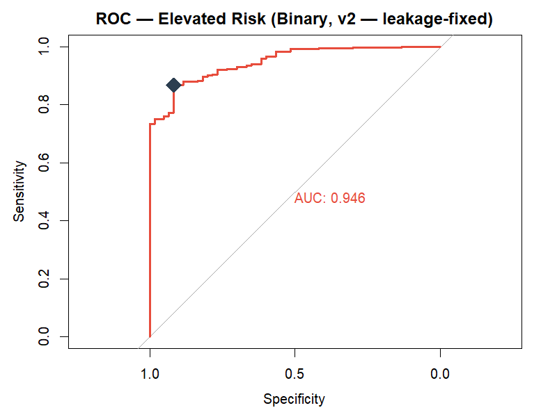
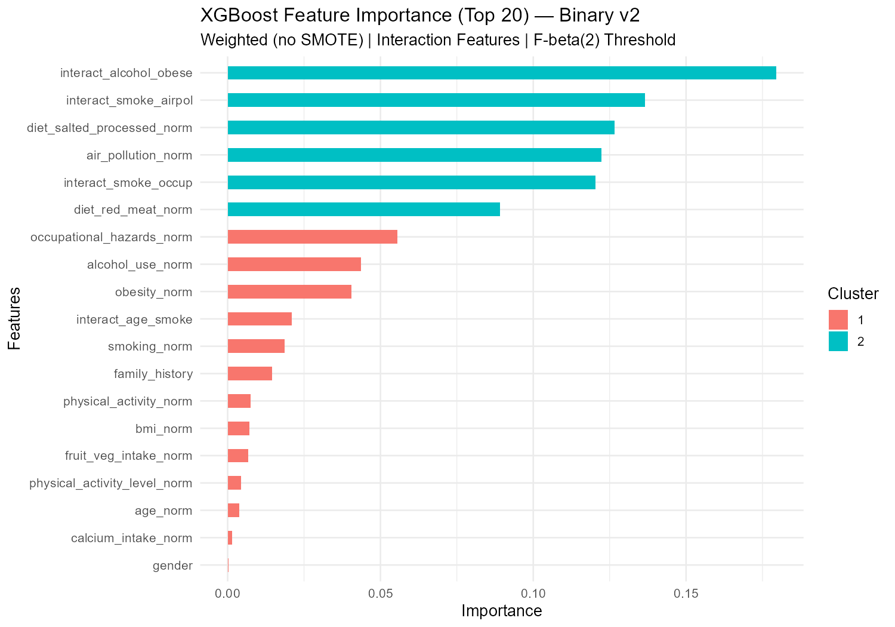
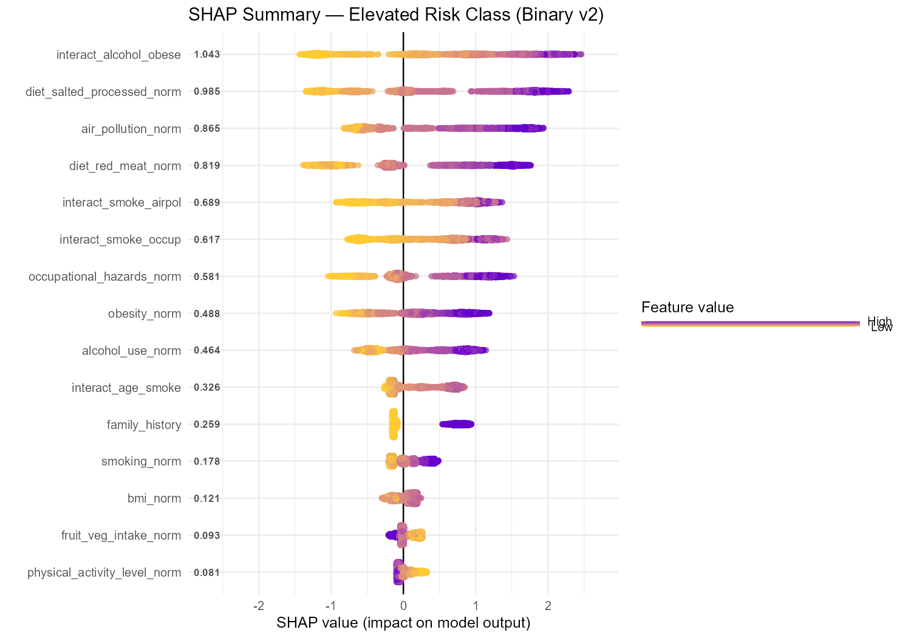
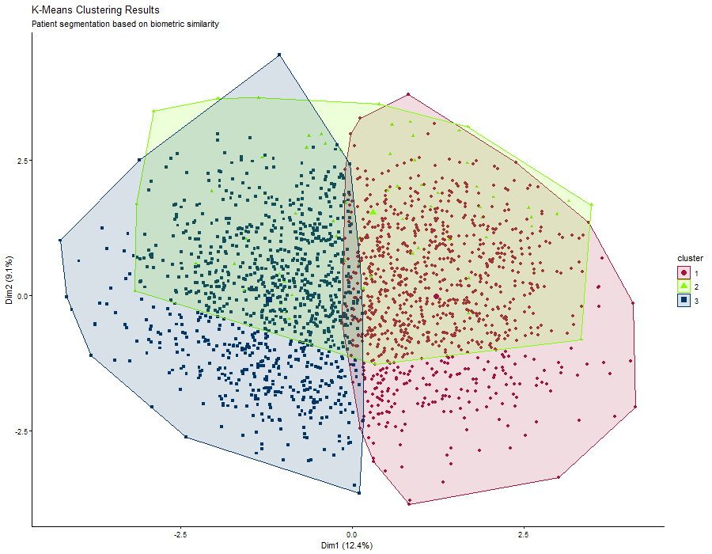
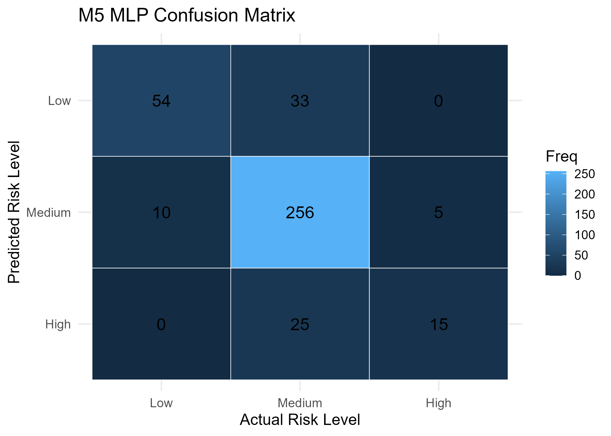

# OncoShield-AI

**Cancer risk prediction and patient segmentation using an integrated machine learning and deep learning framework in R.**


## Table of Contents
- [Overview](#overview)
- [Dataset](#dataset)
- [Project Structure](#project-structure)
- [Pipeline (M1–M5)](#pipeline-m1m5)
- [Key Results](#key-results)
- [Visualizations](#visualizations)
- [OncoShield AI (R-Shiny App)](#oncoshield-ai-r-shiny-app)
- [How to Run](#how-to-run)
- [Limitations](#limitations)
- [Disclaimer](#disclaimer)
- [Authors](#authors)

## Overview
Early identification of cancer risk is crucial for timely medical intervention. This project delivers a comprehensive 5-module analytical framework and an interactive R-Shiny dashboard (**OncoShield AI**).

The system uses a **dual-engine architecture**:
- **XGBoost** – a high-sensitivity binary classifier for preliminary screening (Elevated vs. Normal) that minimizes false negatives.
- **Multi-Layer Perceptron (MLP)** – a neural network for granular 3-tier risk stratification (Low, Medium, High).

This work aligns with **Sustainable Development Goal 3 (Good Health and Well-Being)**.

## Dataset
| Item | Details |
|---|---|
| **Source** | [Cancer Risk Factors Dataset](https://www.kaggle.com/datasets/tarekmasryo/cancer-risk-factors-dataset) by Tarek Masryo (Kaggle) |
| **Observations** | 2,000 patients, 21 raw columns (clinical, lifestyle, genetic, demographic) |
| **Target** | `risk_level` (Low: 16.2% / Medium: 78.7% / High: 5.1%) |

> The dataset contains mixed data types (numerical and categorical) and satisfies the multivariate requirements for the 5-module framework.

## Project Structure
```text
OncoShield-AI/
├── data/       raw/, processed/, and outputs/ (K-Means results)
├── models/     Trained models (XGBoost & Keras MLP)
├── reports/    Analytical output folder
│   ├── plots/  CSV metrics, summary tables, and confusion matrices (.csv)
│   └── tables/ Visual charts, ROC curves, and cluster figures (.png)
├── scripts/    Analysis pipeline (run in order)
├── app/        R-Shiny dashboard code
└── README.md
```

## Pipeline (M1–M5)
| Script | Module | What it does |
|---|---|---|
| `01_dataprep.R` | M1 | Cleaning (median/mode imputation), factor encoding, Min-Max normalization |
| `02_xgboost.R` | M2 | Binary classifier (Elevated vs Normal), 5-fold CV, F-beta(2) threshold tuning, SHAP |
| `03_apriori.R` | M3 | Association rules (support 0.005, confidence 0.5, lift > 1) for high-risk profiles |
| `04_kmeans.R` | M4 | K-Means clustering (k=3) to segment patients by biometric similarity |
| `05_mlp.R` | M5 | 3-class neural network (Low/Medium/High) using Keras/TensorFlow |

## Key Results
| Model | Metric | Value |
|---|---|---|
| XGBoost (M2) | AUC | 0.9448 |
| XGBoost (M2) | Sensitivity (Recall) | 99.41% (threshold = 0.10) |
| XGBoost (M2) | Precision / Specificity | 90.13% / 38.33% |
| MLP (M5) | Test Accuracy | 80.9% (Loss: 0.429) |
| MLP (M5) | Macro Recall / F1-Score | 79.9% / 68.9% |
| K-Means (M4) | Cluster Sizes (k=3) | Cluster 1: 954, Cluster 2: 65, Cluster 3: 981 |

## Visualizations

### ROC Curve (XGBoost – Binary v2)
Shows the Youden optimal point (threshold = 0.648) vs. the chosen clinical threshold (0.10).



### XGBoost Feature Importance (Top 20)
Interaction features (e.g., alcohol + obesity, smoking + air pollution) dominate the decision-making process.



### SHAP Summary (Elevated Risk Class)



### K-Means Clustering (PCA Projection)
Visualization of the three distinct biometric patient profiles.



### M5 MLP Confusion Matrix (3-Class)
Misclassifications occur primarily at the boundary between Low and Medium risk.



## OncoShield AI (R-Shiny App)
A reactive, web-based dashboard built with Shiny and shinydashboard.

- **Cohort Registry** – real-time Create, Read, and Update (CRUD) operations for patient data.
- **Dual-Engine Inference** – parses user inputs through two pre-trained models simultaneously: XGBoost (threshold 0.35 for dashboard inference) and the Keras MLP.
- **Exploratory Intelligence** – live Apriori association rules and interactive K-Means cluster projections.

## How to Run
1. Open the project as an **RStudio Project** (so relative paths work).
2. Install the R packages:
   ```r
   install.packages(c("tidyverse", "janitor", "xgboost", "caret", "pROC",
                      "SHAPforxgboost", "arules", "arulesViz", "factoextra",
                      "keras3", "shiny", "shinydashboard"))
   ```
3. For the MLP, use Python 3.11 and install the TensorFlow backend:
   ```r
   keras3::install_keras()
   ```
4. Run scripts `01` to `05` in `scripts/` in order to generate models and outputs.
5. Launch the dashboard:
   ```r
   shiny::runApp("app/")
   ```

## Limitations
- **Class imbalance:** Medium risk accounts for 78.7% of samples, which expands the decision boundary for this class and pulls down the MLP macro precision (64.1%).
- **Sensitivity vs. specificity trade-off:** XGBoost uses a conservative threshold (0.10) to reach 99.41% sensitivity, giving a high false positive rate (specificity 38.33%). This intentionally shifts error away from missed diagnoses toward secondary diagnostic testing.
- **Boundary overlap:** Patient risk is a continuous spectrum; borderline Low/Medium cases have overlapping features that challenge discrete classification.
- **Small sample rules:** Apriori association rules for "High" risk rest on relatively small counts.
- **Not a clinical tool:** For educational and research purposes only.

## Disclaimer
This project is for educational and research purposes only. The models and insights generated here do not constitute medical advice, diagnosis, or treatment. Always consult a qualified healthcare provider for medical concerns.

## Authors
Department of Mathematics and Statistics, Faculty of Applied Sciences and Technology, Universiti Tun Hussein Onn Malaysia (UTHM), Pagoh, Johor, Malaysia.

Corresponding author: [logen@uthm.edu.my](mailto:logen@uthm.edu.my)